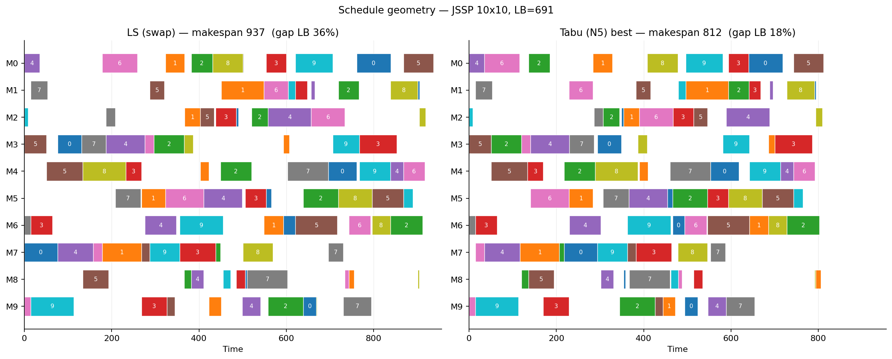

# Metaheuristics Portfolio

A collection of metaheuristic studies on classical operations research problems.
Each folder is a self-contained project with its own code, experiments, figures
and README. The emphasis throughout is on interpretation: what the parameters
do, how the algorithms behave as the problem changes, and why.

## Key findings

- **JSSP:** Tabu Search with a critical-path neighbourhood beats generic
  methods on both quality and effort: 1.7% from the best schedule found,
  while evaluating 35× fewer schedules than ILS.
- **The same neighbourhood can be the worst or the best choice:** N5 as a plain
  descent is the weakest method; inside Tabu it is the strongest.
- **TSP:** plain 2-opt stays 5–6% behind at every size; ILS is the most
  consistent method on small and medium instances.
- **Lower bounds can mislead:** a loose bound made an easy instance look like
  the hardest one.

## Projects

| Folder | Problem | Algorithms | Focus |
|---|---|---|---|
| [`tsp/`](tsp/) | Euclidean Travelling Salesman Problem | LS, ILS, GLS, SA | scaling, parameter sweeps, convergence, tour geometry |
| [`jssp/`](jssp/) | Job Shop Scheduling Problem | LS, ILS, SA, Tabu | neighbourhood effect, tenure sweep, instance shape, computational budget, Gantt geometry |

Both projects follow the same method (the JSSP runs are additionally seeded, so
its numbers reproduce exactly; the TSP runs reproduce the distributions but not
the exact values). Each algorithm is run 20 to 30 times on a
fixed instance, results are reported as distributions rather than single runs,
and the differences the text relies on are checked with non-parametric tests
(`stats.py` in each folder). Each README includes a section of practical
takeaways and ends with the limitations of the study.

Requires Python 3.10+. Install dependencies with `pip install -r requirements.txt`.
