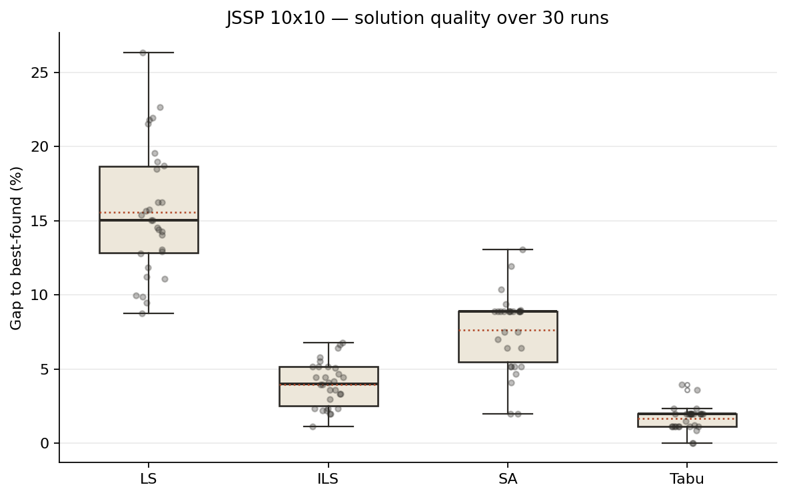
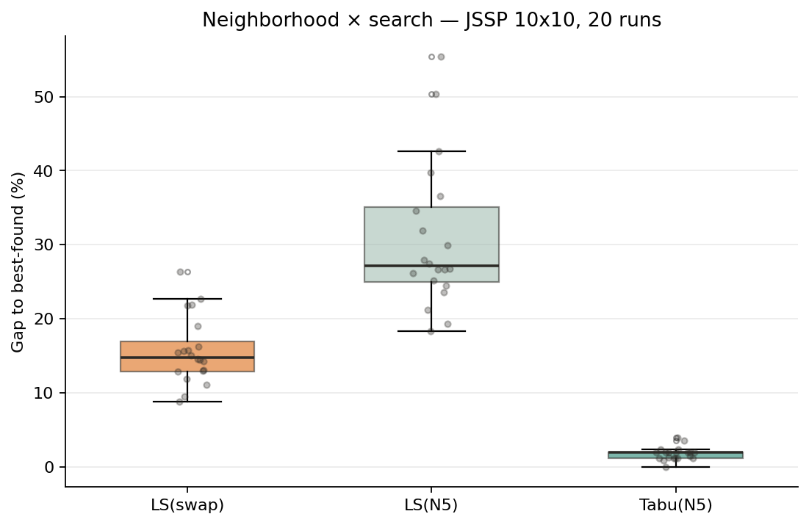
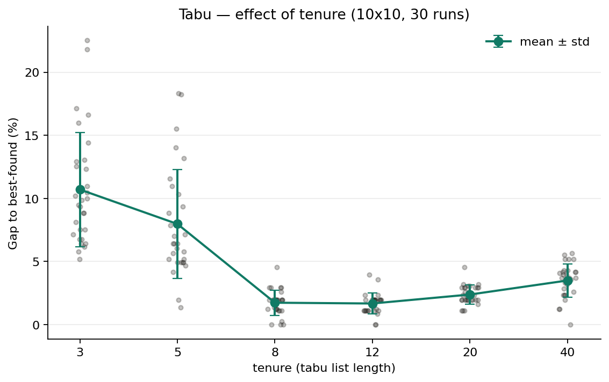
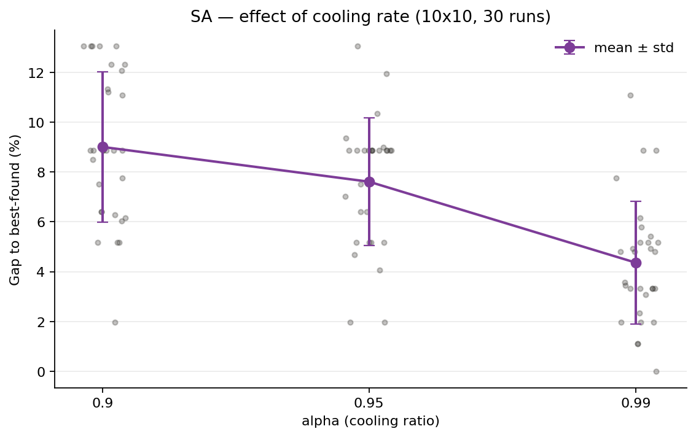
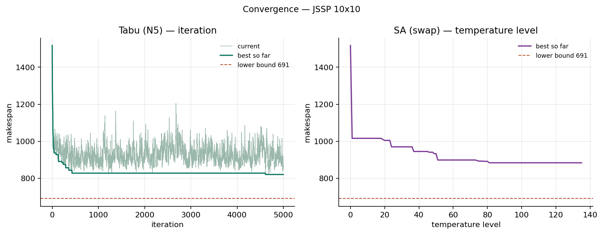
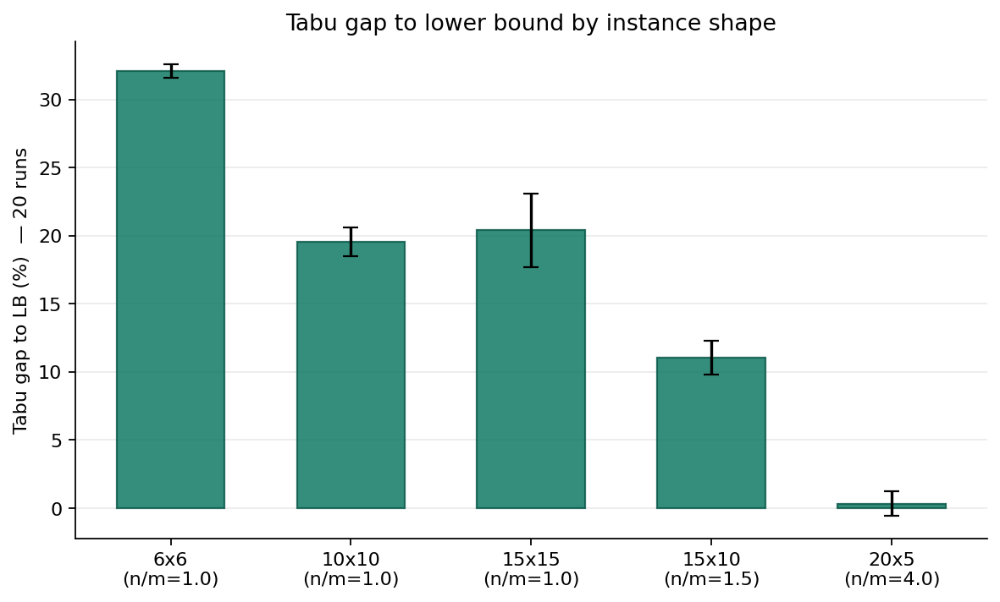
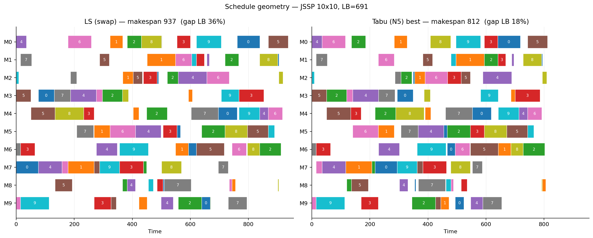

# Metaheuristics on the Job Shop — LS, ILS, SA, Tabu

A comparative study of four metaheuristics on the Job Shop Scheduling Problem
(JSSP): Local Search (LS), Iterated Local Search (ILS), Simulated Annealing
(SA) and Tabu Search. The study looks at solution quality and consistency, the
effect of the search neighbourhood, the effect of each algorithm's main
parameter, convergence behaviour, and how instance shape affects the results.

As in the companion TSP study, every comparison is based on the distribution of
repeated runs rather than a single run. Two things are new here: the problem has
hard constraints, and the same neighbourhood can be the worst or the best choice
depending on the search that drives it.

## Why this problem matters in practice

The job shop is the textbook model of a production floor where each job follows
its own route through the machines: a machining cell, a print shop, a hospital
lab where each sample visits analysers in a different order, a repair workshop.
The objective used here — makespan, the time the last job finishes — is the
classic measure of throughput. The instances studied (from 6×6 to 15×15) are the
size of a small cell or a daily scheduling window. The algorithms are the ones
expected to produce a workable schedule in seconds to minutes when the job mix
changes from one shift to the next.

## The problem

There are `n` jobs and `m` machines. Each job has `m` operations; operation `o`
of a job must run on a specified machine for a specified time. The operations of
a job must run in order (job precedence), and a machine runs one operation at a
time (machine capacity). The goal is to minimise the makespan.

- Instances are generated in the Taillard style: for each job, a random
  permutation of the machines as its routing, and processing times drawn
  uniformly from `[1, 99]`.
- `random_instance(..., seed=42)` fixes the instance so the numbers in this
  README can be reproduced; `seed=None` draws a fresh one each run.

## Solution representation

A solution is an **operation-based permutation**: a sequence of length `n·m` in
which each job number appears exactly `m` times. The k-th occurrence of a job
number is that job's k-th operation. Every permutation of this sequence decodes
to a feasible schedule — no repair and no penalty term is needed. This is the
design decision that lets the same LS / ILS / SA engines from the TSP study
carry over to a constrained problem.

The decoder places each operation as early as its job predecessor and its
machine both allow (a semi-active schedule), in `O(n·m)`.

## The reference frame — a computed lower bound

The generated instances have no published optimum, so the reference is a
**lower bound** computed from the instance itself:

- Job bound: no schedule can finish before the longest job's total processing
  time.
- Machine bound: for each machine, (smallest head) + (its total load) +
  (smallest tail), where the head of an operation is the work that must precede
  it within its job and the tail is the work that must follow.
- The lower bound is the larger of the two.

Two reference numbers are reported:

- **gap to LB** — distance to this lower bound. The bound is loose (the true
  optimum sits somewhere above it), so this figure overstates the real gap and,
  more importantly, compresses the algorithms together.
- **gap to best-found** — distance to the best makespan found anywhere in the
  experiment. This reveals the *relative* quality of the algorithms, which is
  what the comparison is about.

Reading both is itself part of the analysis: on the main instance the best
schedule found is about 17.5% above the lower bound, so "gap to LB" puts every
algorithm in a 19–36% band and hides the differences, while "gap to best-found"
separates them cleanly.

## The algorithms

LS, ILS and SA use a **swap** neighbourhood on the permutation (exchange two
positions holding different jobs). Tabu uses a different, problem-aware
neighbourhood described below.

### LS — Local Search (swap, first improvement)

Start from a random permutation; apply the first swap that shortens the makespan
and repeat until none does. No escape from a local optimum.

### ILS — Iterated Local Search

Run LS, perturb the local optimum with a double-bridge move (which preserves the
multiset, so the result is still feasible), run LS again, keep the better. Escapes
by perturbation. Parameter: `n_iterations`.

### SA — Simulated Annealing

A single solution, random swap moves, accept an improving move always and a
worsening one with probability `e^(−Δ/T)`, cool geometrically. Parameter:
`alpha` (cooling ratio).

### Tabu Search (critical-block / N5 neighbourhood)

The canonical job-shop metaheuristic. It does not use swap. Instead it works on
the **machine ordering** and moves only operations on the **critical path** —
the chain of operations that determines the makespan. The N5 neighbourhood
(Nowicki & Smutnicki) swaps the first two or last two operations of each critical
block (only the last two in the first block and only the first two in the last
block, since the other swaps cannot shorten the makespan). A short-term tabu
list forbids reversing recent moves; an
aspiration rule lets a tabu move through if it beats the best-so-far. Parameter:
`tenure` (tabu list length).

Why not GLS, the fourth algorithm from the TSP study? GLS needs the objective to
decompose into per-feature costs — the TSP has this (edges), the makespan does
not, since it is the length of a critical path rather than a sum over features.
Rather than force a poor fit, this study substitutes Tabu, which is the standard
choice for the job shop and whose strength depends on exactly the critical-block
neighbourhood introduced here.

## Experimental setup

- Main instance: `10×10`, `seed=42`. Shape study uses `{6×6, 10×10, 15×15,
  15×10, 20×5}`.
- Runs: 30 per algorithm for the main comparison and parameter sweeps, 20 for
  the neighbourhood and shape studies. Same instance across the runs of a batch.
  Run `k` uses `seed=k`, so every number in this README can be reproduced
  exactly. Because the scripts share seeds, the same configuration gives the
  same runs everywhere: the 10×10 Tabu runs with tenure 12 in Results 1, 2, 3
  and 5 are the same runs, not separate experiments.
- Settings: ILS `n_iterations = 50`; SA `T0 = 2 × mean processing time`,
  `iter_per_T = n·m`, `T_min = 0.1`, `alpha = 0.95` unless stated; Tabu
  `max_iter = 5000`, `tenure = 12` unless stated.
- Long scripts checkpoint to JSON and resume if interrupted.

## Results 1 — Main comparison (10×10)

Thirty runs. Lower bound 691, best schedule found 812.

| Algo | Mean | Median | Std | Min | gap LB | gap best |
|---|---:|---:|---:|---:|---:|---:|
| LS   | 938.6 | 934.0 | 35.6 | 883 | 35.8% | 15.6% |
| ILS  | 844.2 | 844.5 | 12.2 | 821 | 22.2% |  4.0% |
| SA   | 873.8 | 884.0 | 20.9 | 828 | 26.5% |  7.6% |
| Tabu | 825.6 | 828.0 |  6.7 | 812 | 19.5% |  1.7% |



Tabu wins on both quality (1.7% from the best found) and consistency (standard
deviation 6.7, roughly a fifth of LS's). Its lead over ILS is statistically
clear (Mann-Whitney, p < 0.001, A12 = 0.92: a random Tabu run beats a random
ILS run 92% of the time). This matches the job-shop literature, where
critical-path Tabu is the standard strong baseline. Note how "gap to LB" alone
would have made the four look similar (19–36%); the best-found reference is
what shows Tabu is more than twice as close as ILS and nine times closer than LS.

### How much search each algorithm does

The four algorithms stop at their own natural points, so they do not use the
same amount of computation. `budget.py` counts how many schedules each one
evaluates (mean over five runs):

| Algo | Schedules evaluated | Time (s) |
|---|---:|---:|
| LS              |    29 124 |  0.5 |
| ILS             | 1 087 214 | 20.9 |
| SA (alpha 0.95) |    12 143 |  0.3 |
| SA (alpha 0.99) |    61 785 |  1.2 |
| Tabu            |    31 054 |  2.9 |

This changes how the ranking should be read. ILS evaluates about 35 times more
schedules than Tabu and still finishes behind it, so the budget difference
makes the case for Tabu stronger, not weaker. The gap between ILS and SA is a
different matter: SA at `alpha = 0.95` uses about 1% of ILS's budget. With
`alpha = 0.99`, SA reaches a mean of 847.4 and cannot be separated from ILS
(p = 0.78). The main comparison uses `alpha = 0.95`, which the sweep in
Results 3 shows is not SA's best setting, so the ILS-over-SA result is mostly
a budget effect.

## Results 2 — A neighbourhood is only as good as the search that drives it

The same N5 neighbourhood is both the worst and the best performer here,
depending on the search that drives it.



| Method | Mean | gap best |
|---|---:|---:|
| LS (swap) |  939.0 | 15.6% |
| LS (N5)   | 1061.5 | 30.7% |
| Tabu (N5) |  826.2 |  1.8% |

As a plain descent, N5 is **worse** than swap (p < 0.001): it is a small
neighbourhood (only the ends of critical blocks), so it reaches a local optimum
quickly and stops. But that same small, focused neighbourhood is exactly what
makes Tabu strong. Every N5 move changes the critical path, so a search that
can accept worsening moves keeps making progress instead of grinding through
swaps that leave the makespan untouched. The lesson: a neighbourhood has no
quality on its own; it has a quality *in combination with a search*.

The design has two limits worth stating. LS(swap) uses first improvement and
LS(N5) uses best improvement, so the first comparison also changes the pivoting
rule. And Tabu was not run with the swap neighbourhood, so the experiment shows
the interaction between neighbourhood and search but cannot say which of the
two matters more.

## Results 3 — Parameter sweeps (10×10)

### Tabu — tenure (tabu list length)



A clear bathtub. A short tenure (3–5) is poor and highly variable; the usual
explanation is that the list is too short to stop the search cycling back to
solutions it just left. A long tenure (40) is also worse; it forbids so many
moves that the search cannot intensify around a good region. The minimum is
flat at 8–12: the two cannot be separated (p = 0.63), while the step from 5 to
8 and the steps from 12 to 20 and from 20 to 40 are all significant (p < 0.01
after Holm correction). The experiment shows the shape of the curve; the
cycling and over-restriction explanations come from the literature and were
not measured directly.

### SA — cooling ratio (`alpha`)



Slower cooling (higher `alpha`) gives better schedules, from about 9% at 0.90
to about 4% at 0.99. The step from 0.95 to 0.99 is significant (p < 0.001);
the step from 0.90 to 0.95 is not (p = 0.13). The gain has a price: the number
of temperature levels grows from about 65 at 0.90 to about 685 at 0.99, and
`alpha = 0.99` evaluates about five times as many schedules as 0.95.

One detail in the raw points is worth noting: 12 of the 30 runs at
`alpha = 0.95` end at exactly 884. This suggests that with a short cooling
schedule, many different starting points are drawn into the same local optimum.

## Results 4 — Convergence behaviour



Tabu's signature is unlike a descent method. Its **current** makespan swings
up and down throughout the run, because at every iteration Tabu moves to the
best neighbour that is not tabu, even when that neighbour is worse than the
current schedule. Its **best-so-far** falls quickly to 828 after about 430
iterations, then holds for more than 4 000 iterations before a late
improvement to 821 near iteration 4 600. The wandering current line is the
escape mechanism made visible: it does find a better region, but slowly. The
long plateau suggests that restarts or a stronger perturbation could reach
such improvements sooner; this was not tested.

SA's best-so-far descends in steps and settles above Tabu's level. Both traces
are single runs, and the x-axes count different things (Tabu iterations, SA
temperature levels), so the panels compare the shape of the two searches, not
their speed.

## Results 5 — Instance shape and the limits of the lower bound

The job-shop literature reports that instances with many more jobs than
machines (`n/m` well above 1) are easy, and that square instances (`n/m = 1`)
are the hard ones. Tabu was run on five shapes to see whether this shows up
here.



| Shape | n/m | LB | Best found | Runs reaching best | Gap LB (best) | Mean gap to best | Std (makespan) |
|---|---:|---:|---:|---:|---:|---:|---:|
| 6×6   | 1.0 |  326 |  430 | 17/20 | 31.9% | 0.15% |  1.6 |
| 10×10 | 1.0 |  691 |  812 |  1/20 | 17.5% | 1.75% |  7.3 |
| 15×15 | 1.0 |  969 | 1127 |  1/20 | 16.3% | 3.52% | 26.1 |
| 15×10 | 1.5 |  920 | 1007 |  1/20 |  9.5% | 1.47% | 11.5 |
| 20×5  | 4.0 | 1194 | 1194 | 17/20 |  0.0% | 0.33% | 11.0 |

The figure, which plots gap to LB, seems to say that difficulty falls as `n/m`
rises. The table shows that this reading is mostly about the lower bound, not
about difficulty:

- **6×6** has the largest gap to LB, yet 17 of 20 runs return the same
  makespan. The instance is easy and 430 is probably optimal; the 32% gap is
  almost entirely looseness in the bound.
- **20×5** reaches the lower bound itself in 17 of 20 runs, so those schedules
  are proven optimal. This agrees with the literature: when each machine
  processes many jobs, the machine-load bound is nearly achievable.
- **Measured by consistency** (how often runs reach the best value and how far
  they stray from it), the hardest instance is 15×15, then 10×10. Both have
  `n/m = 1`, so size matters as well as shape.

Two limits apply. Each shape is represented by a single instance, so the effect
of shape cannot be separated from the difficulty of that particular instance.
And Tabu runs a fixed 5 000 iterations at every size. The result agrees with
the literature at the extremes, but this experiment does not show that shape
matters more than size.

## Results 6 — Schedule geometry



The Gantt charts show what a smaller makespan looks like on the floor. The two
panels share a time axis. The LS schedule (left, makespan 937) is a typical LS
run, close to the LS mean of 938.6; the Tabu schedule (right, makespan 812) is
the best found in the whole study. The total processing time is fixed at 4 888,
so every unit of makespan saved is idle time removed from the machines
(idle time = 10 × makespan − 4 888). Idle time falls from 4 482 to 3 232
machine-time units, and average machine utilisation rises from 52% to 60%.

## Practical takeaways

- **Shift-to-shift rescheduling:** Tabu with the N5 neighbourhood and a tenure
  of 8–12. It gives the best schedules, the smallest spread between runs, and
  runs in about 3 seconds on a 10×10 instance.
- **Tenure is the parameter to watch.** Below 8 the quality drops sharply;
  above 20 it degrades slowly. If in doubt, a slightly long tenure is safer
  than a short one.
- **Plain LS is not good enough.** Its schedules are on average about 15%
  longer than the best found; on a cell with an 8-hour makespan that is
  roughly 75 extra minutes.
- **Generic swap-based methods need far more computation.** ILS gets within
  4% of the best found, but only by evaluating about 35 times more schedules
  than Tabu. For the job shop, a problem-specific neighbourhood is the cheaper
  route to good schedules.
- **Rectangular cells (many jobs, few machines) look like the easy case.** On
  20×5, Tabu reached the lower bound, and therefore the optimum, in 17 of 20
  runs. With one instance per shape this is an indication, not a result.

## How to run

Requires Python 3.10+, matplotlib and scipy.

```bash
cd jssp     # scripts read and write files in their own folder
pip install -r ../requirements.txt

python3 jssp.py             # one run of LS, ILS, SA on the main instance
python3 analysis.py         # 30 runs × 4 algorithms          -> analysis.png
python3 neighborhood.py     # swap vs N5 vs Tabu              -> neighborhood.png
python3 param_sweep.py      # Tabu tenure + SA alpha sweeps   -> param_*.png
python3 convergence.py      # Tabu and SA traces             -> convergence.png
python3 shape_analysis.py   # Tabu gap to LB by n/m ratio    -> shape.png
python3 gantt_viz.py        # schedule geometry LS vs Tabu   -> gantt.png
python3 stats.py            # significance tests, shape table -> printed (~1 s)
python3 budget.py           # schedules evaluated per algo    -> printed (~2 min)
```

The long scripts write a `*_results.json` checkpoint after each batch and resume
from it if interrupted.

## Repository layout

```
jssp/
├── jssp.py                 # library: problem, decoder, lower bound,
│                           #   LS / ILS / SA (swap), N5 + Tabu, Gantt
├── analysis.py             # 30-run comparison of the four algorithms
├── neighborhood.py         # swap vs N5, as descent and inside Tabu
├── param_sweep.py          # Tabu tenure and SA alpha sweeps
├── convergence.py          # traced Tabu (current/best) and SA
├── shape_analysis.py       # Tabu on five instance shapes
├── gantt_viz.py            # LS vs Tabu schedule geometry
├── stats.py                # Mann-Whitney U, A12, Holm; shape table
├── budget.py               # schedules evaluated and run time per algorithm
├── *.png                   # the figures above
├── *_results.json          # checkpoints
├── best_solution.json      # best schedule found (Tabu, seed=3); regenerated by gantt_viz if missing
└── README.md
```

## Design decisions

- **Operation-based permutation.** Every permutation is feasible, so the
  unconstrained TSP engines carry over to a constrained problem without repair
  or penalty machinery.
- **Two reference numbers.** The lower bound is computed, not looked up, and it
  is loose; reporting both gap-to-LB and gap-to-best-found keeps the absolute
  picture honest while still separating the algorithms.
- **A problem-aware neighbourhood for Tabu.** The critical-block N5 move is the
  point of the study, not an implementation detail; the neighbourhood comparison
  isolates its effect.
- **An algorithm dropped on principle.** GLS is left out and Tabu put in its
  place because the makespan does not decompose the way GLS needs, and Tabu is
  the standard job-shop method. Fitting the algorithm to the problem is stated,
  not hidden.
- **Distributions, seeds and checkpoints.** Every run is seeded and results are
  reported as distributions. Differences the text relies on are checked with a
  Mann-Whitney U test, the A12 effect size and a Holm correction (`stats.py`).
  p-values quoted in the text are unadjusted; every conclusion drawn from them
  also holds after the Holm correction.
  Long scripts checkpoint to JSON.

## Limitations and next steps

- **A tighter lower bound** (for example a one-machine relaxation with
  preemption) would shrink the gap-to-LB inflation and make the shape study
  cleaner.
- **Equal-budget comparison.** The algorithms run to their own natural stopping
  points, and their budgets differ by a factor of about 90 (`budget.py`).
  Comparing them at an equal number of evaluated schedules would show whether
  SA can match ILS and how much of Tabu's lead survives.
- **Several instances per shape.** The shape study uses one instance per shape.
  Ten instances per shape would separate the effect of shape from the
  difficulty of a single instance.
- **A stronger neighbourhood** (N6/N7, or insertion of a critical operation)
  and Tabu with restarts would close more of the remaining gap.
- **Objectives beyond makespan** — total weighted tardiness, for instance —
  which connect directly to due-date-driven production planning.
