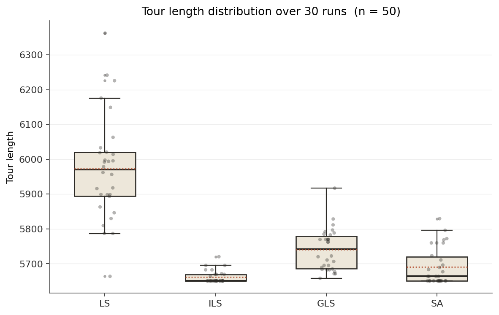
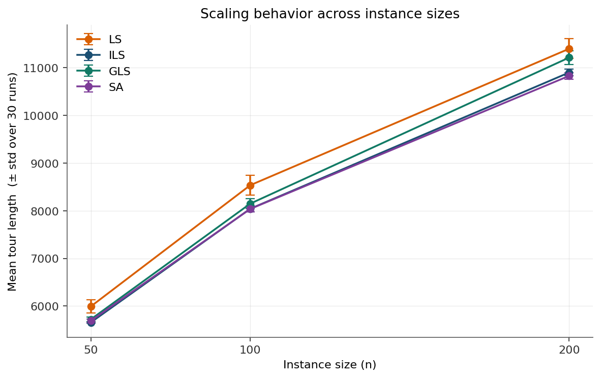
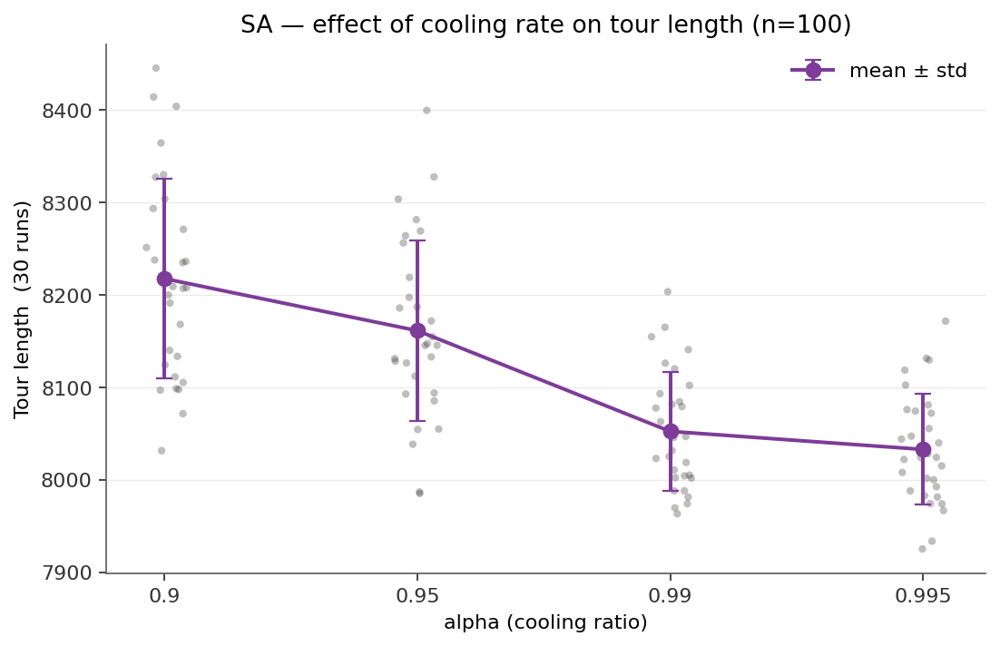
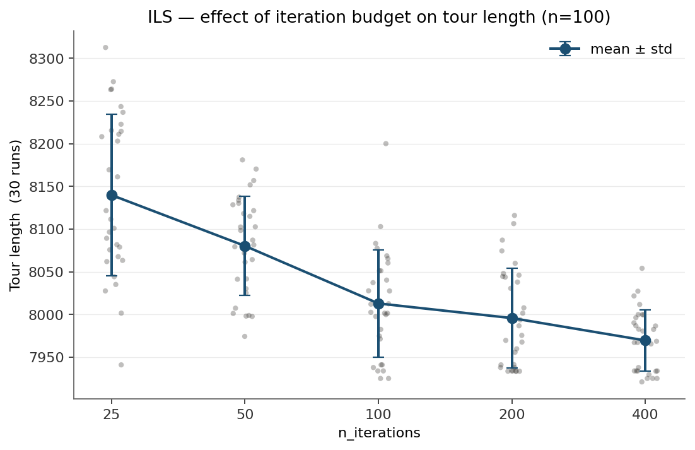
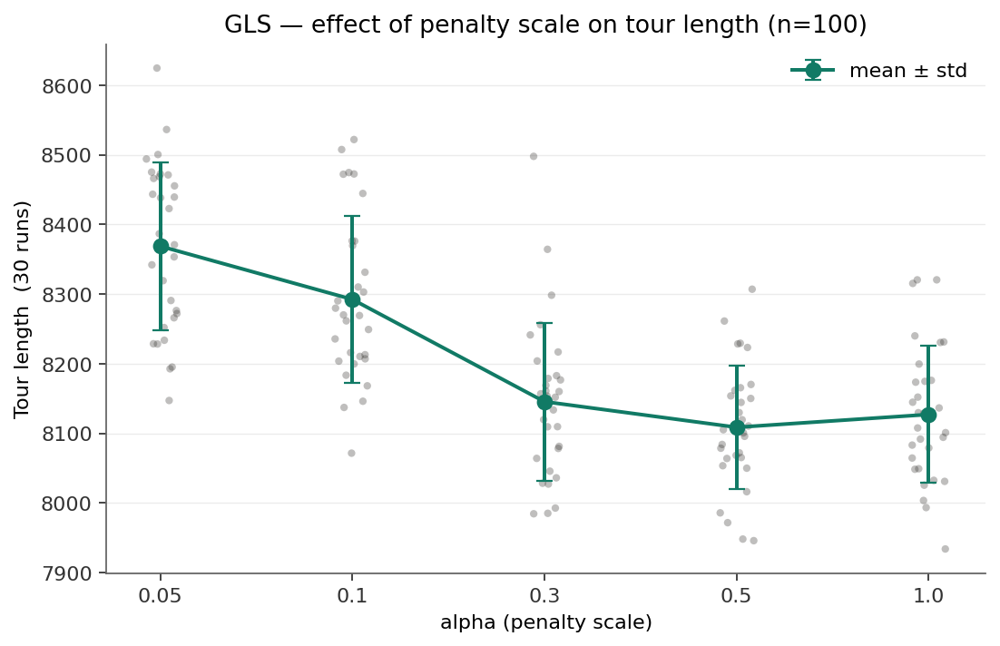
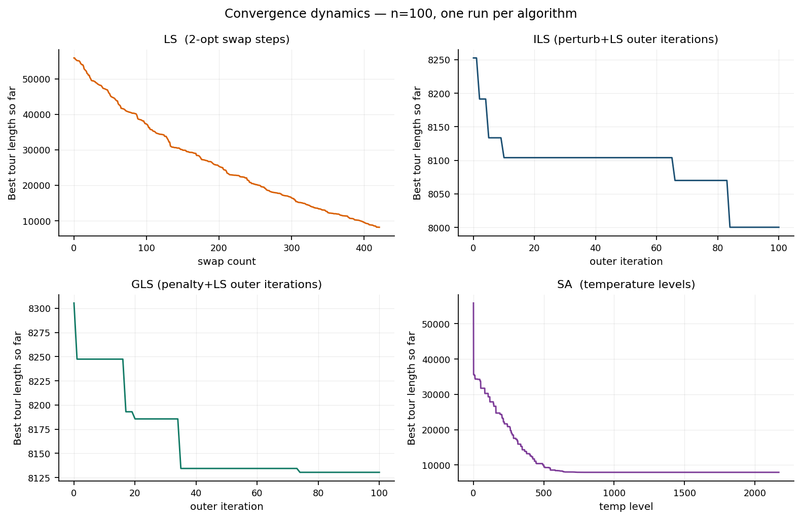
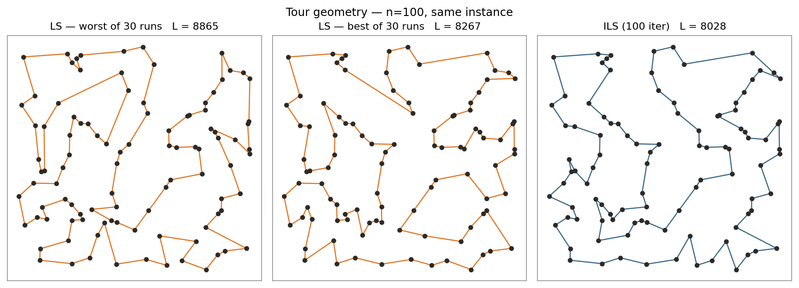

# Metaheuristics on the TSP — LS, ILS, GLS, SA

A comparative study of four metaheuristics — Local Search (LS), Iterated Local
Search (ILS), Guided Local Search (GLS) and Simulated Annealing (SA) — on
randomly generated Euclidean Travelling Salesman Problem instances. The study
goes beyond the question "which one is best" and looks at four things together:
how each algorithm behaves as the instance grows, how its main parameter shapes
the result, how it converges, and what the resulting tours actually look like.

One methodological rule runs through the whole project: metaheuristics are
stochastic, so a single run tells you very little. Every comparison here is
based on the distribution of 30 runs on a fixed instance.

## Why this problem matters in practice

The TSP sits underneath many everyday problems in industrial engineering:
vehicle routing for delivery and field service, sequencing jobs on a production
line to cut changeover time, tool-head movement on drilling and cutting
machines, picker routes in a warehouse, and nurse or technician visit plans.
The 100–200 city instances used here are roughly the size of a daily delivery
route or a mid-sized sequencing problem. The algorithms studied are the kind
expected to return a "good enough" answer within seconds to minutes when the
operational input changes every day.

## The problem

Given `n` cities on a 2D plane, find the shortest closed tour that visits every
city exactly once. The problem is NP-hard; for `n = 100` there are
`(n−1)!/2 ≈ 4.7 × 10¹⁵⁵` distinct tours.

- Instances: `n` points drawn uniformly from the `[0, 1000] × [0, 1000]` square.
- Distances: Euclidean, `d(i,j) = √((xᵢ−xⱼ)² + (yᵢ−yⱼ)²)`, symmetric.
- Objective: total edge length of the closed tour (to be minimised).

## The algorithms

All four share the same problem layer and the same `tour_length` objective.
They differ only in how they move through the solution space.

### LS — Local Search (2-opt, first improvement)

Start from a random tour. Whenever reversing a segment between two edges
shortens the tour, apply it immediately and start scanning again. Stop when no
improving move exists — that point is a **local minimum**. There is no escape
mechanism, so the final quality depends heavily on the luck of the starting
tour.

### ILS — Iterated Local Search

ILS fixes the main weakness of LS. On reaching a local minimum, it perturbs the
tour with a **double-bridge** move (a 4-opt move that 2-opt cannot undo on its
own), then runs LS again from the perturbed tour. If the new local minimum is
better, it is kept. Many local minima are visited over the course of a run.

- Parameter: `n_iterations`.
- Acceptance rule: improvements only.

### GLS — Guided Local Search

GLS escapes local minima by changing the objective rather than the tour. Each
edge carries a penalty counter `p(i,j)`. LS runs on the augmented cost
`h = d + λ·p`. At a local minimum, the edges with the highest utility
`util = d / (1 + p)` are penalised, which forces the next LS pass to break
them.

- Parameters: `alpha` (sets `λ = alpha · L₀ / n`, where `L₀` is the length of
  the first local minimum), `n_iterations`.

### SA — Simulated Annealing

Keep a single tour and propose random 2-opt moves. A move with Δ < 0 is always
accepted; a move with Δ ≥ 0 is accepted with probability `e^(−Δ/T)`. The
temperature `T` is multiplied by `alpha` after each batch of moves, so the
search explores early and settles late.

- Parameters: `alpha` (cooling ratio), `T0` (initial temperature, set
  automatically from the average edge cost), `iter_per_T`.

## Experimental setup

- Instance sizes: `n ∈ {50, 100, 200}` for the scaling study; `n = 100` for the
  parameter sweeps, convergence traces and tour plots.
- Fixed instance: `random_instance(n, seed=42)`, so every run of every
  algorithm works on exactly the same set of cities. Set
  `instance_seed=None` in the scripts to draw a fresh instance.
- Runs: 30 per algorithm, per instance size, per parameter value. Using the
  same instance for all 30 runs isolates the variance that comes from the
  algorithm itself, rather than from instance difficulty.
- Internal randomness: each run uses its own unseeded random stream.

## Results 1 — Baseline comparison (n = 50)

Summary statistics over 30 runs (tour length; lower is better):

| Algorithm | Mean | Median | Std | Min | Max |
|---|---:|---:|---:|---:|---:|
| LS  | 5973.1 | 5970.3 | 149.7 | 5663.6 | 6362.7 |
| ILS | 5661.0 | 5650.6 |  17.8 | 5650.6 | 5720.1 |
| GLS | 5740.7 | 5741.8 |  59.9 | 5658.0 | 5917.1 |
| SA  | 5691.2 | 5663.6 |  53.4 | 5650.6 | 5829.4 |



ILS and SA both reach 5650.6, and GLS comes within eight units of it.
Three different methods converging on the same value makes 5650.6 a
reasonable best-known value for this instance, although optimality has
not been proven. LS never reaches it; its best run stops at 5663.6. The
lack of an escape mechanism has a measurable cost.

The standard deviation column is as informative as the mean. LS is spread over
a range of 700 units; ILS over 70. "Best on average" and "most consistent" are
different questions, and here ILS wins both.

## Results 2 — Scaling with instance size (n = 50, 100, 200)



| n | LS mean (std) | ILS mean (std) | GLS mean (std) | SA mean (std) |
|---:|---:|---:|---:|---:|
|  50 |  5991.7 (136.0) |  5656.4 (10.7) |  5720.9 (44.2) |  5690.4 (37.0) |
| 100 |  8535.4 (205.2) |  8041.2 (60.3) |  8148.3 (102.6) |  8037.6 (57.9) |
| 200 | 11398.6 (207.6) | 10899.9 (67.2) | 11213.1 (144.1) | 10829.6 (72.3) |

(The n = 50 row comes from a separate batch of 30 runs from the one in
Results 1. The small differences between the two — for example 5973 vs 5992 for
LS — are the run-to-run variability of the mean itself. A useful reminder that
even a 30-run average carries noise.)

Three things stand out as `n` grows:

- **LS stays about 5–6 % behind the best method at every size.** The
  absolute gap grows from about 340 units at `n = 50` to about 570 at
  `n = 200`, but tour length grows as well. In relative terms the cost of
  having no escape mechanism is roughly constant.
- **SA overtakes ILS at `n = 200`.** At `n = 50` ILS is significantly
  better (Mann-Whitney, p < 0.001), at `n = 100` the two cannot be
  separated (p = 0.78), and at `n = 200` SA is significantly better
  (p < 0.001). This should not be read as SA scaling better by nature.
  SA performs `n(n−1)/2` moves per temperature level, so its budget grows
  with `n²`, while ILS runs a fixed 100 iterations at every size. The
  comparison is confounded by budget.
- **GLS falls behind at scale.** At `n = 50` it occasionally reaches the
  best-known value; at `n = 200` it is about 380 units (3.5 %) behind SA.
  The most likely reason is the fixed budget of 100 penalty iterations,
  which covers a smaller share of the search on a larger instance. This
  was not tested directly.

## Results 3 — Parameter sweeps (n = 100)

### SA — cooling ratio (`alpha`)



Slower cooling gives shorter tours, and the improvement is monotonic
across the range tested. Part of this effect is budget: the number of
temperature levels grows from about 100 at `alpha = 0.90` to about 2 170
at `alpha = 0.995`. The step from 0.99 to 0.995 is worth about 20 units
on average and is not statistically significant (p = 0.28).
`alpha = 0.999` was tested once and dropped from the sweep, as it needs
about five times the compute of 0.995. Practical reading: `alpha = 0.99`
is the sensible default.

### ILS — iteration budget (`n_iterations`)



A clear case of diminishing returns. Going from 25 to 100 iterations improves
the mean by about 130 units; going from 100 to 400 adds only 45 more. The knee
of the curve is around 100. For most purposes `n_iterations` in the 100–200
range is the right setting; beyond 400 the extra time buys almost nothing.
The differences between 100 and 200 iterations (p = 0.30) and between
200 and 400 (p = 0.07) are not statistically significant at the 5 % level.

### GLS — penalty scale (`alpha`)



The response is a step followed by a plateau:

- `alpha = 0.05, 0.1`: penalties are too weak to push LS out of its
  basin reliably, so the search gains only part of what GLS can offer.
  Means of 8 290–8 370, between plain LS (about 8 535) and the plateau.
- `alpha = 0.3` to `1.0`: the means lie between 8 108 and 8 146 and are
  not statistically distinguishable (p > 0.2 for every pair).

The GLS literature suggests that very large penalties should eventually
hurt, because the augmented cost stops reflecting the real one. This
sweep does not extend far enough to show that. Any value between 0.3 and
1.0 is a reasonable default on this instance.

## Results 4 — Convergence behaviour



Each algorithm has its own signature:

- **LS:** a steady, almost linear descent from about 55 000 to 8 000 over
  roughly 400 swaps. Classic greedy 2-opt; it stops as soon as it hits a
  plateau.
- **ILS:** a staircase. Each step down is a new local minimum; each flat
  stretch is a series of perturbations that failed to improve. The descent is
  discontinuous because the search jumps between basins.
- **GLS:** a similar staircase, but it levels off earlier — around 8130 after
  100 iterations on this run. The penalties accumulate, but on this instance
  they do not dig as deep as ILS does.
- **SA:** a steep exponential-looking descent through the first 500
  temperature levels, then a long plateau of fine-tuning.

The plot also shows why "same number of iterations" is not a fair comparison:
LS is finished after 400 swaps, SA runs for more than 2 000 temperature levels.
A fair comparison needs an equal budget of objective evaluations, or equal
wall-clock time. Each trace is a single run, so the curves illustrate typical
behaviour rather than measure it. The exact positions of the ILS and GLS steps
change from run to run.

## Results 5 — Tour geometry



The geometry behind the numbers:

- **LS, worst of 30 runs (L = 8865):** no crossing edges, since 2-opt
  removes every crossing, but several long jumps between distant parts
  of the plane. The tour is untangled locally and badly ordered globally.
- **LS, best of 30 runs (L = 8267):** fewer long jumps, but a handful
  remain.
- **ILS (L = 8028):** consecutive cities are close together and the long
  jumps are gone. The double-bridge move lets the search reorder whole
  segments of the tour, which a single 2-opt move cannot do.

The difference between 8865 and 8028 is, in geometric terms, the removal
of long detours. Note that the LS panels show the best and worst of 30
runs, while the ILS panel is a single run. The picture explains what the
metaheuristic is doing in a way the number alone cannot.

## Practical takeaways

- **Daily re-planning with a short time limit:** ILS with 100–200
  iterations. It gives the best quality for its effort at small and
  medium sizes and is among the most consistent methods, so the plan produced 
  on one day is close in quality to the plan produced on the next.
- **Larger instances with more time available:** SA with
  `alpha = 0.99` is a reasonable candidate, though its lead at
  `n = 200` is partly a budget effect (Results 2). Going to 0.995
  doubles the run time without a significant gain.
- **Plain LS is not enough on its own.** It is consistently 5–6 % worse.
  On a 200 km daily route that is roughly 10–12 km per vehicle per day.
- **GLS needs a budget that grows with the instance.** With a fixed 100
  iterations it falls behind as `n` grows.

## How to run

Requires Python 3.10+, matplotlib and scipy.

```bash
cd tsp      # scripts read and write files in their own folder
pip install -r ../requirements.txt

python3 tsp.py               # single run of all four algorithms, prints four numbers
python3 analysis.py          # 30 runs × 4 algorithms at n=50   -> analysis.png   (~1 min)
python3 scale_analysis.py    # scaling study, n = 50/100/200     -> scale.png      (~30 min)
python3 param_sweep.py       # parameter sweeps at n=100         -> param_*.png    (~25 min)
python3 convergence.py       # convergence traces at n=100       -> convergence.png (~1 min)
python3 tour_viz.py          # tour plots at n=100               -> tours.png      (~30 s)
python3 stats.py             # significance tests on cached results  -> printed table (~1 s)
```

The two long-running scripts write a checkpoint after every completed batch
(`scale_results.json`, `param_results.json`). If a run is interrupted, the
next invocation picks up where it left off.

## Repository layout

```
tsp/
├── tsp.py                # library: problem layer + LS, ILS, GLS, SA
├── analysis.py           # baseline 30-run comparison (n=50)
├── scale_analysis.py     # scaling study, n ∈ {50, 100, 200}
├── param_sweep.py        # parameter sweeps for SA, ILS, GLS (n=100)
├── convergence.py        # convergence traces (traced copies of the algorithms)
├── tour_viz.py           # tour geometry plots
├── stats.py              # Mann-Whitney U, A12 and Holm correction on cached results
├── analysis.png          # output of analysis.py
├── scale.png             # output of scale_analysis.py
├── param_sa.png          # output of param_sweep.py — SA
├── param_ils.png         # output of param_sweep.py — ILS
├── param_gls.png         # output of param_sweep.py — GLS
├── convergence.png       # output of convergence.py
├── tours.png             # output of tour_viz.py
├── scale_results.json    # checkpoint for scale_analysis.py
├── param_results.json    # checkpoint for param_sweep.py
└── README.md
```

## Design decisions

A few choices in this project were deliberate and worth stating:

- **Distributions, not point estimates.** Thirty runs per setting, reported as
  mean, standard deviation, minimum and maximum. Differences that the text
  relies on are checked with a Mann-Whitney U test and the A12 effect size,
  with a Holm correction for the number of comparisons (`stats.py`).
  p-values quoted in the text are unadjusted; every conclusion drawn from
  them also holds after the Holm correction.
- **Same instance for all runs of a batch.** The alternative — one run each on
  thirty different instances — mixes algorithm variance with instance variance
  and makes the two impossible to separate.
- **Reproducibility.** The instance is fixed, so the problem is identical
  on every machine. Individual runs are not seeded: re-running a script
  reproduces the distributions closely, but not the exact numbers.
- **Checkpointing.** The two long scripts cache results after every batch, so
  an interrupted run does not throw away completed work.
- **Raw observations on the parameter plots.** Each sweep plot shows the 30
  individual results as jittered points next to the mean and error bar. The
  reader can see outliers and skew directly, rather than trusting the summary.
- **A dropped parameter value, with the reason stated.** `alpha = 0.999` for SA
  was left out of the sweep on cost grounds. Saying so is more useful than
  pretending the sweep was exhaustive.

## Limitations and next steps

This project establishes a baseline. The natural extensions are:

- **Other instance types.** Clustered, grid-like or coastline-shaped point
  sets change the fitness landscape; the ranking of the algorithms may change
  with them.
- **Equal-budget comparison.** SA's budget grows with `n²`, while ILS and
  GLS use a fixed number of iterations. Counting objective evaluations
  and comparing at equal budgets would show whether SA's advantage at
  `n = 200` survives.
- **Time–quality trade-off.** Compare the algorithms at equal wall-clock time
  rather than equal iteration counts.
- **Hybrids.** ILS with GLS-style penalties; multi-start SA followed by a GLS
  polish on the best few.
- **Other neighbourhoods.** Replace the 2-opt engine with or-opt or 3-opt and
  see how ILS and GLS respond.
